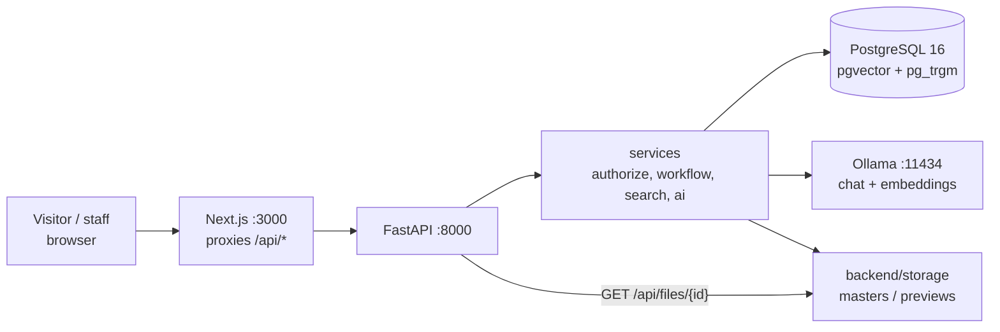
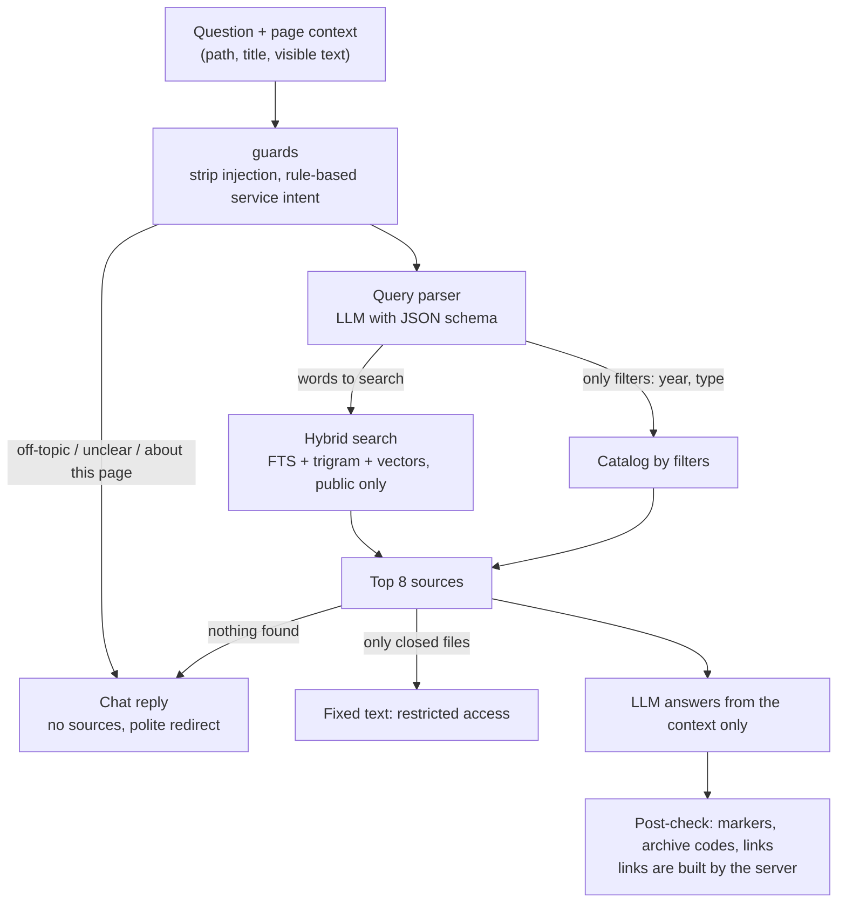

<p align="center">
  
</p>

<h1 align="center">State Archive of East Kazakhstan Region</h1>

<hr>

<p align="center"><b>Catalog, search and an AI assistant in one place: access checked on the server, a local language model, publication only through approval</b></p>

<p align="center">
  
  
  
  
  
  
</p>

<!-- Status badges (CI, release) are omitted: the repository has no workflows or releases. -->

<p align="center">
  <a href="#architecture-deep-dive">Architecture</a> · <a href="#setup--deployment">Quick start</a> · <a href="docs/">Documentation</a> · <a href="docs/DEPLOYMENT.md">Why local Docker</a> · <a href="LICENSE">MIT</a>
  <br>
  English · <a href="README.ru.md">Русский</a>
</p>

---

## Executive Summary

A new public website and staff admin for the State Archive of East Kazakhstan Region. One electronic
catalog (funds, inventories, cases, documents with a scan viewer), search in Kazakh, Russian and English, an online-exhibitions and
"memory archive" section (collections, persons, timeline, historical map), a branch map and an AI assistant that answers only from
what it finds on the site. The home page starts from the visitor's task (task chips, rotating example queries), search and the
assistant accept voice input and can read answers aloud, and an open document card offers a ready archival reference ("How to cite").

The hard part is access. A closed document is never served by a card, a file URL, the API or an AI answer: the server decides on every
path, and the search index holds only public objects. Every material is published through a role-based approval workflow. The site is
information-only: there are no application forms, orders or payments, only links to eGov.kz and e-Otinish.

**Architecture we are ready to stand behind.** We built this as a system that can go live, not as a demo. Routers stay thin, the rules live
in services, and a single `authorize(user, action, object)` stands in front of every read and write, so a closed document cannot slip out
through a forgotten route. Search, vectors and access rules sit in one PostgreSQL. Roles, an approval workflow, an audit log, migrations and
719 backend tests are there from day one. We run the whole stack, language model included, in local Docker rather than in a Firebase-style
cloud on purpose: Kazakhstan's personal data law (No. 94-V) calls for such data to be stored in a database located in the country, and a
vendor cloud would have forced us to rewrite the data and auth layers. Here the system moves to any server in Kazakhstan with three volumes
and one `.env` file. The reasoning and its sources are in [docs/DEPLOYMENT.md](docs/DEPLOYMENT.md).

**Designed for the person at the screen.** Visitors rarely know what a "fond" or an "inventory" is, but they always know their task. So the
home page starts with a question: ask in your own words, type it or say it into the microphone, or pick a task under "Where to start".
Answers arrive in Kazakh, Russian or English with sources you can open, the scan viewer is one click away, and an open document gives a ready
archival reference for a paper or a request. Read-aloud, theme and motion settings and a calm interface (hairline lists, one blue for
actions) are there for a simple reason: an archive should be easy to use for everyone, not only for those who know how it is organised.

## Technical Stack

| Group | Technologies | Where pinned |
|---|---|---|
| Core | Python 3.12, FastAPI, SQLAlchemy 2, Alembic, Pydantic v2 | `backend/requirements.txt`, `backend/Dockerfile` |
| Core | Next.js 15 (App Router), React 19, TypeScript 5, Tailwind CSS 4, next-intl, next-themes, Leaflet, TipTap | `frontend/package.json` |
| Data | PostgreSQL 16 with pgvector and pg_trgm | `docker-compose.yml` (`pgvector/pgvector:pg16`) |
| Data | Files on disk (`backend/storage`), Pillow, pypdfium2 for previews | `backend/requirements.txt` |
| AI/ML | Ollama: chat model `qwen3.5:9b-q4_K_M`, embeddings `bge-m3` (1024 dims) | `.env.example`, `docker-compose.yml` |
| AI/ML | Tesseract (`rus+kaz+eng`) for staff OCR tools | `backend/Dockerfile` |
| Auth | argon2id passwords, JWT in an `HttpOnly` `SameSite=Strict` cookie, optional Google sign-in for visitors | `backend/app/security.py` |
| Infra | Docker Compose (db, ollama, ollama-models, backend, frontend), Makefile | `docker-compose.yml`, `Makefile` |

## Architecture Deep Dive

Layers, data model and API contract are described in [docs/ARCHITECTURE.md](docs/ARCHITECTURE.md).



The browser talks to one origin: Next.js rewrites `/api/*` to FastAPI, so session cookies can stay `SameSite=Strict`.

### AI assistant



If Ollama is down, search and the catalog keep working and the AI blocks show a fixed "temporarily unavailable" text. Details: [docs/AI.md](docs/AI.md).

### Decisions

| Decision | Why | Record |
|---|---|---|
| Search inside PostgreSQL, no separate search server | One store to back up and one place where visibility is enforced; full text, trigram and vector rankings are fused with RRF | [docs/DECISIONS.md](docs/DECISIONS.md) |
| Authorization in services through one `authorize(user, action, obj)` | Closed files and drafts cannot leak through a forgotten route; refusals are 404, not 403 | [docs/DECISIONS.md](docs/DECISIONS.md) |
| Local Docker instead of a managed cloud platform | Personal data must be stored in a database located in Kazakhstan; a vendor platform would force a rewrite of data and auth layers | [docs/DEPLOYMENT.md](docs/DEPLOYMENT.md) |

## Project Structure

```text
.
├── backend/            FastAPI application
│   ├── app/            routers, services, repositories, models, ai
│   ├── alembic/        database migrations
│   ├── seed/           demo content, real images, shipped translations, bootstrap
│   └── tests/          pytest suite (access matrix, AI, search, workflow)
├── frontend/           Next.js site and admin (src/app, src/components, messages kk/ru/en)
├── info/               customer source files read by the seed (history, contacts, branches, funds)
├── docs/               architecture, AI, decisions, deployment rationale, demo script
├── docker-compose.yml  db, ollama, ollama-models, backend, frontend
├── docker-compose.gpu.yml  optional NVIDIA GPU for Ollama
└── Makefile            env, up, dev, test, backup
```

## Setup & Deployment

### Everything in Docker (recommended)

```bash
git clone <repository-url> && cd <repository-directory>
make up            # creates .env with random secrets, then runs `docker compose up --build`
```

Without `make`:

```bash
cp .env.example .env     # set POSTGRES_PASSWORD, JWT_SECRET and DEMO_PASSWORD
docker compose up --build
```

On the first start the stack downloads the Ollama models (several GB), applies migrations, seeds the demo catalog and creates demo
staff accounts. Open <http://localhost:3000> (the API is on <http://localhost:8000>, docs at `/docs`).

> [!NOTE]
> With an NVIDIA GPU: `docker compose -f docker-compose.yml -f docker-compose.gpu.yml up --build`. On a CPU the assistant works but answers slowly.
> Search and the catalog do not depend on the model.

> [!WARNING]
> The session cookie is `Secure`. Browsers accept it on `http://localhost`; if you open the site by an IP address over plain http, set
> `SESSION_COOKIE_SECURE=false` in `.env`.

### Demo accounts

Created on first start when `DEMO_PASSWORD` is set (`make env` sets it to `Demo-Pass-2026!`). Admin area: `/ru/admin`.

| Role | Login |
|---|---|
| Chief administrator | `superadmin@demo.kz` |
| Site administrator | `siteadmin@demo.kz` |
| Editor | `editor@demo.kz` |
| Archivist | `archivist@demo.kz` |
| Moderator | `moderator@demo.kz` |
| Analyst | `analyst@demo.kz` |

### Local development without Docker for the app

```bash
make dev                    # env files, PostgreSQL in Docker, dependencies, migrations, then the API on :8000 (stays in the foreground)
# in other terminals:
cd backend && DEMO_PASSWORD='Demo-Pass-2026!' .venv/bin/python -m seed.bootstrap   # roles, demo data, demo accounts, search index
make frontend-install && make frontend-dev         # site on :3000
make test                                          # backend tests
```

Install [Ollama](https://ollama.com) and pull the models: `ollama pull qwen3.5:9b-q4_K_M && ollama pull bge-m3`. For OCR install Tesseract
(`sudo apt install tesseract-ocr tesseract-ocr-rus tesseract-ocr-kaz tesseract-ocr-eng`).

<details>
<summary>Environment variables</summary>

Root `.env` (Docker Compose):

| Variable | Default | Purpose |
|---|---|---|
| `POSTGRES_USER` | `vko` | Database user |
| `POSTGRES_PASSWORD` | `change_me` | Database password (`make env` generates a random one) |
| `POSTGRES_DB` | `vko_archive` | Database name |
| `POSTGRES_PORT` | `5432` | Host port, bound to localhost only |
| `JWT_SECRET` | `change_me_jwt_secret` | Signing key of session tokens, at least 32 random characters |
| `DEMO_PASSWORD` | `change_me_demo_password` | Password of the demo staff accounts; empty means none are created |
| `OLLAMA_MODEL` | `qwen3.5:9b-q4_K_M` | Chat model pulled on first start |
| `OLLAMA_EMBED_MODEL` | `bge-m3` | Embedding model |
| `SESSION_COOKIE_SECURE` | `true` | Mark session cookies `Secure` |
| `GOOGLE_CLIENT_ID` | empty | Enables "Sign in with Google" in the visitor cabinet |

Backend-only settings (`backend/.env.example`): `OLLAMA_URL`, `OLLAMA_FALLBACK_MODEL`, `OLLAMA_VISION_MODEL`, `OLLAMA_NUM_CTX`,
`OLLAMA_NUM_PREDICT`, `AI_MAX_CONCURRENT_GENERATIONS`, `AI_RATE_LIMIT_PER_MINUTE`, `FRONTEND_URL`, `SMTP_*` (mail is not sent when
`SMTP_HOST` is empty), `CORS_ORIGINS`.

</details>

<details>
<summary>Troubleshooting</summary>

- The assistant says it is unavailable: the models are still downloading (`docker compose logs ollama-models`) or `ollama` is not healthy.
- Search finds words but no semantic matches: vectors are computed after the first start; they appear when Ollama has the `bge-m3` model.
- Reset everything: `docker compose down -v && docker compose up --build` recreates the database, files and accounts.
- Backup: `make backup` writes a `pg_dump` into `backups/`.

</details>

## Documentation

| Document | Contents |
|---|---|
| [docs/ARCHITECTURE.md](docs/ARCHITECTURE.md) | Layers, data model, API contract |
| [docs/AI.md](docs/AI.md) | Models, assistant pipeline, guards, how to install the model |
| [docs/DEPLOYMENT.md](docs/DEPLOYMENT.md) | Why local Docker instead of a cloud platform |
| [docs/DECISIONS.md](docs/DECISIONS.md) | Numbered engineering decisions |
| [docs/DESIGN.md](docs/DESIGN.md) | Design system rules |
| [docs/DATA_SOURCES.md](docs/DATA_SOURCES.md) | Data sources and image licences |
| [docs/OPEN_ISSUES.md](docs/OPEN_ISSUES.md) | Known gaps and next steps |
| [docs/READINESS.md](docs/READINESS.md) | Readiness of every module: implemented, partial, simulated, next stage |
| [docs/MIGRATION.md](docs/MIGRATION.md) | Plan for migrating data from the old site e-arhiv.vko.gov.kz |

## License

MIT, see [LICENSE](LICENSE). Images from Wikimedia Commons keep their own licences (see `backend/seed/assets/credits.json`).
