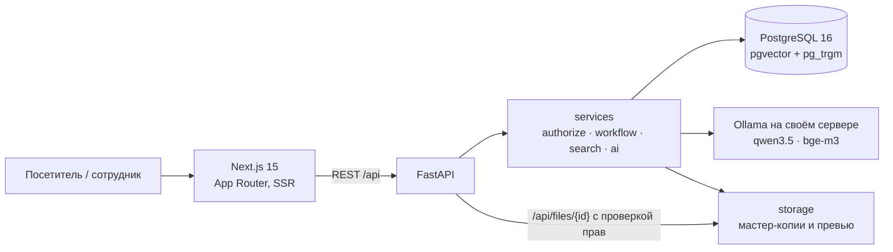
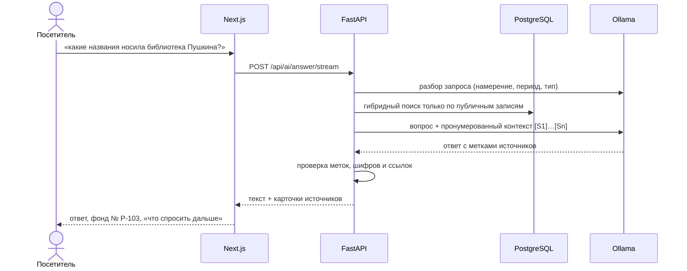

<p align="center">
  <h1 align="center">Государственный архив ВКО — новый сайт</h1>
  <p align="center"><b>Архив, в котором находят.</b><br>
  Фонд, документ, справку или филиал — за минуту, на казахском, русском и английском.</p>
</p>

<p align="center">
  
  
  
  
  
  
  
</p>

<p align="center">
  <a href="#что-получает-посетитель">Посетителю</a> · <a href="#что-получает-архив">Архиву</a> · <a href="#как-закрыто-тз">ТЗ</a> · <a href="#архитектура">Архитектура</a> · <a href="#быстрый-старт">Запуск</a> · <a href="#показ-по-публичной-ссылке">Показ по ссылке</a> · <a href="docs/DEMO_SCRIPT.md">Сценарий показа</a>
</p>

---

## Коротко

Code Masters Hackathon 9.0. Мы не перекрасили старый сайт архива — мы собрали его заново вокруг одного вопроса
обычного человека: **«где мои документы и что мне делать дальше?»**

Сайт отвечает на него тремя способами: навигатор ведёт по шагам, поиск понимает опечатки и смысл запроса,
а архивный помощник отвечает словами и показывает, из какой записи каталога взят ответ.
Под этим — настоящий каталог, проверка доступа на сервере и локальный ИИ, которому не нужен интернет.

| | |
|---|---|
| **1 653** реальных фонда и **119** газет | перечни самого архива (e-arhiv.vko.gov.kz), а не выдуманные записи |
| **57** подлинных изображений | карты, гравюры и фотографии региона с автором и лицензией у каждого |
| **3** языка | казахский, русский, английский — интерфейс, поиск и ответы помощника |
| **14** подразделений на карте | головной архив и филиалы: адрес, телефон, часы, маршрут |
| **0** внешних ИИ-сервисов | модель работает на своём сервере, вопросы посетителей никуда не уходят |
| **749** автотестов backend | на живой PostgreSQL, включая проверки доступа и ответы помощника |

## Что получает посетитель

- **Навигатор «Где искать документы».** Человек называет цель и организацию — сайт находит фонд, даже если
  организация пять раз меняла название, и говорит, что делать дальше: читальный зал или справка через eGov.kz.
- **Архивный помощник.** Вопрос своими словами → ответ со списком фактов, карточка источника с номером фонда
  и подсказки «что спросить дальше». Не знает ответа — так и говорит. Доступ ограничен — называет условия,
  а не содержание. Его можно позвать прямо со страницы фонда: вопрос об этом фонде задаётся одним нажатием.
- **Электронный каталог.** Документы плиткой с изображениями или строгим списком, фильтры со счётчиками,
  фонды с линией времени прежних названий, газетный фонд, описи и дела. Всё состояние — в адресе: ссылкой
  на выдачу можно поделиться, страница работает и без JavaScript.
- **Поиск, который прощает.** Полнотекст, опечатки и смысл запроса в одной выдаче; быстрый поиск по `Ctrl/⌘ + K`
  с любой страницы.
- **Большой архив памяти.** Тематические коллекции, биографии, хронология региона, историческая карта
  и онлайн-выставки с просмотрщиком экспонатов.
- **Филиалы и карта.** Список и карта в одном окне, маршрут в 2GIS, Google и Яндекс Картах.
- **Услуги без тупиков.** Порядок, сроки, документы и основания отказа — по действующим правилам;
  заявление подаётся на eGov.kz, и сайт честно говорит об этом на каждом шаге.
- **Удобно каждому.** Версия для слабовидящих (кегль, контраст, интервалы, без изображений), светлая и тёмная
  темы, «вы недавно смотрели», избранное в личном кабинете, телефон — полноценный экран, а не уменьшенный сайт.

## Что получает архив

- **Публикация только через согласование.** Автор готовит, проверяющий одобряет или возвращает с замечанием,
  публикует тот, у кого есть право. Семь ролей, права проверяет сервер.
- **Каталог под рукой.** Фонды → описи → дела → документы, цифровые копии с условиями доступа,
  импорт и экспорт таблицами с отчётом по каждой строке.
- **ИИ-инструменты сотрудника.** Черновик аннотации и теги к документу — всегда как предложение,
  которое человек принимает или отклоняет.
- **Три языка без хаоса.** Раздел переводов показывает, что не переведено и что переведено машиной и ждёт проверки.
- **Прозрачность.** Журнал действий человеческим языком, аналитика поисковых запросов (что ищут и не находят),
  состояние базы, модели и поискового индекса на одном экране.

## Как закрыто ТЗ

| Требование | Решение |
|---|---|
| Сайт только информационный: без заявлений, заказов и оплаты | форм подачи нет нигде, включая чат; eGov.kz и e-Otinish — помеченные внешние ссылки |
| KZ / RU / EN | маршруты `/kk`, `/ru`, `/en`, переведённый интерфейс, отметка «нет перевода» там, где текста на языке нет |
| Светлая и тёмная темы | светлая по умолчанию, тёмная — по выбору посетителя |
| Доступ проверяет сервер | `authorize(user, action, obj)` в одном месте; закрытый файл отдаётся как 404; в поисковом индексе только публичное |
| ИИ указывает источники и не выдумывает шифры | ответ строится по пронумерованным записям каталога; ссылки, шифры и карточки формирует сервер и проверяет текст после модели |
| Три проверочные ситуации ИИ | ответ с источником · «не нашёл» · ограниченный доступ — кнопками на странице помощника |
| Демонстрационные данные отделены | вымышленные записи собраны в шести отдельных фондах (Д-1 — Д-6), в каталоге идут после подлинных и перечислены в [docs/DATA_SOURCES.md](docs/DATA_SOURCES.md); отдельной пометки в интерфейсе нет |
| Происхождение открытых материалов | автор, лицензия и ссылка на источник у каждого изображения — [docs/DATA_SOURCES.md](docs/DATA_SOURCES.md) |
| Доступность | цель WCAG 2.2 AA: клавиатура, видимый фокус, подписи, статус текстом, а не только цветом |

## Архитектура

Один репозиторий, три понятных слоя и ни одного сервиса «для красоты». Подробно — [docs/ARCHITECTURE.md](docs/ARCHITECTURE.md),
журнал решений — [docs/DECISIONS.md](docs/DECISIONS.md).



**Три решения, на которых всё держится**

1. **Поиск живёт в PostgreSQL.** Полнотекст (`tsvector`), опечатки (`pg_trgm`) и смысл (`pgvector`, HNSW) сливаются
   через Reciprocal Rank Fusion. Одна СУБД вместо зоопарка: проще развернуть в инфраструктуре заказчика,
   нечему рассинхронизироваться.
2. **Права — в одной точке на сервере.** Каждое действие проходит `authorize`, отказ журналируется,
   файл без права неотличим от несуществующего. Интерфейс только показывает то, что сервер уже разрешил.
3. **ИИ — помощник, а не источник истины.** Модель видит только публичный контекст, отвечает по номерам источников,
   а сервер после неё проверяет каждую ссылку и шифр. Выключили Ollama — каталог, поиск и сайт работают дальше.



## Стек

| Слой | Технологии |
|---|---|
| Frontend | Next.js 15 (App Router), React 19, TypeScript, Tailwind CSS 4, next-intl, Radix Dialog, Leaflet, Tiptap |
| Backend | Python 3.11+, FastAPI, SQLAlchemy 2, Alembic, Pydantic v2, psycopg 3 |
| Данные | PostgreSQL 16 + pgvector + pg_trgm |
| ИИ | Ollama локально: `qwen3.5:9b` (ответы), `bge-m3` (эмбеддинги, 1024) |
| Безопасность | argon2, JWT в httpOnly cookie, CSRF, ограничение частоты ИИ-запросов, заголовки безопасности |
| Качество | pytest на реальной PostgreSQL, Playwright, ESLint, строгий TypeScript |

## Структура проекта

```
backend/
  app/            main.py (приложение), config.py, db.py, deps.py, cli.py, http_security.py
    models/       SQLAlchemy-модели
    schemas/      Pydantic-схемы запросов и ответов
    repositories/ доступ к данным (SQLAlchemy)
    services/     бизнес-логика: authorize, workflow, search, indexing, ai, files
    routers/      public/ — публичный API, admin/ — API админки
    ai/           клиент Ollama, промпты, query parser, RAG, ограждения
  alembic/        миграции (схема меняется только новыми миграциями)
  seed/           наполнение из info/, открытые материалы (Wikimedia Commons) и демо-каталог
  storage/        мастер-копии и превью (не раздаются статикой)
  tests/          pytest на реальной PostgreSQL
frontend/
  src/app/        маршруты Next.js ([locale]: kk / ru / en)
  src/components/ компоненты по разделам
  src/lib/        API-клиент, i18n, SEO
  messages/       строки интерфейса kk / ru / en
  e2e/            сценарии Playwright
docs/             архитектура, решения, ИИ, данные, демо-сценарий, открытые вопросы
info/             исходные материалы заказчика (только чтение)
docker-compose.yml  PostgreSQL 16 + pgvector (сервис db)
Makefile            сборка окружения, миграции, запуск, тесты, резервная копия
```

## Быстрый старт

Требования: Docker с Compose, Python 3.11+, Node.js с npm, `make`. Для ИИ-функций нужна Ollama на хосте.

```bash
ollama pull qwen3.5:9b        # основная модель ответов и разбора запроса
ollama pull bge-m3            # эмбеддинги (поиск и рекомендации)
```

```bash
make dev
```

`make dev` создаёт `.env` и `backend/.env` из примеров со случайным паролем БД и ключом JWT (`make env`),
поднимает PostgreSQL, ставит зависимости backend, применяет миграции и запускает backend (:8000) и frontend (:3000).
Данные `make dev` не загружает — их нужно наполнить отдельно (шаг 3 ниже).

> [!NOTE]
> Если `.env` или `backend/.env` уже создан с примерным паролем `change_me`, `make env` завершится ошибкой.
> Замените пароль на свой в обоих файлах (он должен совпадать) и повторите запуск.

### Пошагово

```bash
# 1. База данных (PostgreSQL 16 + pgvector, сервис db, порт 127.0.0.1:5432)
make env
docker compose up -d --wait db

# 2. Backend и миграции (расширения vector и pg_trgm создаются миграцией 0001)
make backend-install
make migrate

# 3. Наполнение: данные из info/, открытые материалы и демо-каталог (идемпотентно)
cd backend && .venv/bin/python -m seed

# 4. Поисковый индекс и эмбеддинги (эмбеддинги — только если Ollama запущена)
.venv/bin/python -m app.services.indexing

# 5. Backend (в отдельном терминале, из каталога backend/)
.venv/bin/uvicorn app.main:app --reload --port 8000 --no-access-log

# 6. Frontend (в отдельном терминале)
cd frontend && npm install && npm run dev
```

> [!WARNING]
> Флаг `--no-access-log` обязателен и в продакшене: access-лог uvicorn пишет query-строку (поисковый текст)
> мимо маски. Запросы журналирует само приложение (метод, путь, статус, время).

> [!NOTE]
> Без Ollama сайт работает: поиск идёт по словам и названиям, ИИ-блоки показывают «ИИ временно недоступен».
> `GET /api/health` возвращает статусы `db`, `ollama`, `embeddings`; `unavailable` у ИИ не делает сервис недоступным.

> [!TIP]
> Сменить модель ответов можно в `backend/.env` (`OLLAMA_MODEL`, `OLLAMA_FALLBACK_MODEL`), подробности и eval — в [docs/AI.md](docs/AI.md).

### Порты

| Сервис | Порт | Где задаётся |
|---|---|---|
| Frontend (`next dev`) | 3000 | порт по умолчанию Next.js; origin должен быть в `CORS_ORIGINS` |
| Backend API (`/api/...`) | 8000 | `NEXT_PUBLIC_API_URL` (frontend) |
| PostgreSQL (`db`) | 5432 | `POSTGRES_PORT` в `.env` |
| Ollama (на хосте) | 11434 | `OLLAMA_URL` в `backend/.env` |

## Показ по публичной ссылке

```bash
scripts/demo-tunnel.sh
```

Скрипт собирает production-версию сайта, поднимает backend на отдельном порту и открывает Cloudflare Quick Tunnel
(нужен установленный `cloudflared`). Снаружи виден один адрес `https://….trycloudflare.com`: сайт сам проксирует `/api`,
поэтому вход, файлы и помощник работают так же, как локально. Рабочие dev-серверы не затрагиваются; `Ctrl+C` всё гасит.

> [!WARNING]
> По ссылке доступна и админка. Демо-пароль описан в этом репозитории, поэтому перед показом за пределами команды
> смените пароли демо-учёток, а после показа остановите скрипт.

Тот же режим одного адреса годится для обратного прокси: `NEXT_PUBLIC_API_URL=""` и `API_PROXY_TARGET=http://<backend>`
при сборке и запуске frontend.

## Переменные окружения

`.env` (Docker Compose) и `backend/.env` создаются из `.env.example` и `backend/.env.example`; `frontend/.env.example`
содержит адреса для Next.js (скопируйте в `frontend/.env.local`, если нужно изменить). Значения по умолчанию ниже — из примеров;
секреты задаются `make env`.

| Переменная | Файл | По умолчанию в примере | Назначение |
|---|---|---|---|
| `POSTGRES_USER` | `.env` | `vko` | пользователь БД |
| `POSTGRES_PASSWORD` | `.env` | `change_me` (заменяет `make env`) | пароль БД |
| `POSTGRES_DB` | `.env` | `vko_archive` | имя БД |
| `POSTGRES_PORT` | `.env` | `5432` | порт PostgreSQL на localhost |
| `APP_ENV` | `backend/.env` | `development` | `production` скрывает `/docs` и включает HSTS |
| `DATABASE_URL` | `backend/.env` | `postgresql+psycopg://vko:…@localhost:5432/vko_archive` | подключение backend |
| `TEST_DATABASE_URL` | `backend/.env` | `…/vko_archive_test` | отдельная БД для pytest, создаётся автоматически |
| `CORS_ORIGINS` | `backend/.env` | `["http://localhost:3000"]` | разрешённые origin (точные значения) |
| `OLLAMA_URL` | `backend/.env` | `http://localhost:11434` | адрес Ollama |
| `OLLAMA_MODEL` | `backend/.env` | `qwen3.5:9b` | модель ответов |
| `OLLAMA_FALLBACK_MODEL` | `backend/.env` | `qwen3.5:4b` | запасная модель, если основной нет |
| `OLLAMA_EMBED_MODEL` | `backend/.env` | `bge-m3` | модель эмбеддингов (1024 измерения) |
| `OLLAMA_VISION_MODEL` | `backend/.env` | пусто | vision-модель для OCR без Tesseract (пусто — нет) |
| `AI_MAX_CONCURRENT_GENERATIONS` | `backend/.env` | `2` | одновременные генерации на процесс |
| `AI_RATE_LIMIT_PER_MINUTE` | `backend/.env` | `10` | лимит ИИ-запросов с IP в минуту |
| `JWT_SECRET` | `backend/.env` | `change_me_jwt_secret` (заменяет `make env`) | ключ подписи сессий, не короче 32 символов |
| `SESSION_COOKIE_SECURE` | `backend/.env` | `true` | cookie Secure (работает на `https` и `http://localhost`) |
| `NEXT_PUBLIC_API_URL` | `frontend/.env.example` | `http://localhost:8000` | адрес API для браузера и SSR |
| `NEXT_PUBLIC_SITE_URL` | `frontend/.env.example` | `http://localhost:3000` | канонический адрес сайта (canonical, sitemap) |
| `API_PROXY_TARGET` | окружение frontend | не задана | режим одного адреса: Next.js проксирует `/api` на этот backend (вместе с пустой `NEXT_PUBLIC_API_URL`) |

Полный список таймаутов и лимитов — в `backend/.env.example`.

> [!WARNING]
> `JWT_SECRET` и пароли БД никогда не коммитятся; `.env` и `backend/.env` есть в `.gitignore`.
> Значение `change_me…` приложение для ключа сессий не принимает.

## Демо-аккаунты

Сотрудники (роли `super_admin`, `site_admin`, `editor`, `archivist`, `branch_admin`, `moderator`, `analyst`)
создаются командой CLI — в seed их нет. Команды, логины по ролям и сценарий показа описаны в
[docs/DEMO_SCRIPT.md](docs/DEMO_SCRIPT.md). Посетителю готовых учёток нет: личный кабинет открыт для регистрации.

> [!WARNING]
> Демо-пароль только для локальной базы. Для любого публичного стенда смените его или создайте учётки заново.

## Тесты

```bash
make test                       # backend: cd backend && .venv/bin/pytest -q
cd frontend && npm run e2e      # Playwright: отдельные стенд (API :8201, web :3201) и БД vko_archive_e2e
```

- `make test` использует реальную PostgreSQL из docker compose: база `TEST_DATABASE_URL` создаётся и мигрируется
  с нуля в каждой сессии. Тест `test_models_match_migrations` ловит расхождение моделей и миграций.
- `npm run e2e` (скрипт `frontend/e2e/run.sh`) поднимает изолированный стенд, наполняет его и гасит всё в `trap`;
  рабочая база и `.next` не затрагиваются. Нужны запущенный контейнер `vko-archive-db` и свободные порты 8201/3201.
- Сейчас проходят 749 backend-тестов и 42 сценария Playwright (каталог, помощник, услуги, филиалы, выставка,
  согласование, негативные случаи, язык и тема). Скрипт стенда работает на Linux и macOS.
- Оценка ИИ-ответов: `cd backend && .venv/bin/python -m app.ai.eval` (нужна живая модель и демо-данные).

## Резервная копия

```bash
make backup    # pg_dump -Fc из контейнера db → backups/vko_archive_<дата>.dump
# восстановление в пустую базу:
docker compose exec -T db sh -c 'pg_restore -U "$POSTGRES_USER" -d "$POSTGRES_DB" --clean --if-exists' < backups/<файл>.dump
```

Цифровые копии файлов в дамп не входят: каталог `backend/storage/` копируется отдельно (например, `tar`).

## Ограничения

Сайт сделан по ТЗ заказчика и соблюдает его запреты:

- Нет форм заявлений, архивных запросов, заказов, оплаты, регистрации обращений и отслеживания статуса.
  Есть информация и внешние ссылки: eGov.kz и e-Otinish.
- Документы шести демо-фондов и люди в них вымышленные; они собраны в фондах Д-1 — Д-6, в интерфейсе отдельной пометки нет. Перечни фондов — реальные,
  из открытых списков архива (только названия); изображения выставок и «Архива памяти» — подлинные, с Wikimedia Commons,
  в фонды архива не входят. Персональных данных граждан в базе нет.
- ИИ не выдумывает шифры, ссылки и документы: ссылки строит сервер.
- Что реализовано полностью, что частично и что является макетом — в [READINESS.md](READINESS.md);
  открытые вопросы и хвосты — в [docs/OPEN_ISSUES.md](docs/OPEN_ISSUES.md).

## Документация

| Документ | Содержание |
|---|---|
| [docs/ARCHITECTURE.md](docs/ARCHITECTURE.md) | слои, права и согласование, поиск, ИИ, файлы, фронтенд, безопасность, модель данных |
| [docs/DECISIONS.md](docs/DECISIONS.md) | журнал архитектурных решений |
| [docs/AI.md](docs/AI.md) | модели, RAG-поток, ограждения, eval |
| [docs/DATA_SOURCES.md](docs/DATA_SOURCES.md) | что из `info/`, что из открытых источников, что демо, что написано для прототипа |
| [docs/DEMO_SCRIPT.md](docs/DEMO_SCRIPT.md) | подготовка, учётки по ролям, сценарий защиты |
| [docs/OPEN_ISSUES.md](docs/OPEN_ISSUES.md) | открытые вопросы и хвосты |
| [READINESS.md](READINESS.md) | статус готовности: реализовано, частично, макет |

## Лицензия

<!-- TODO: license — в репозитории нет файла LICENSE; добавить после решения заказчика -->
_TBD_: лицензия не указана (нет файла `LICENSE`).
