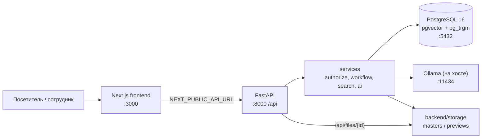
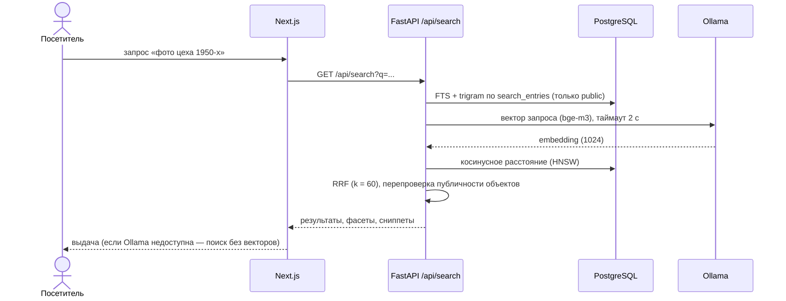

<p align="center">
  <h1 align="center">Государственный архив ВКО — новый сайт</h1>
  <hr>
  <b>Каталог, поиск и ИИ-справка в одном месте: права проверяются на сервере, ИИ работает локально, публикация только через согласование</b>
</p>

<p align="center">
  
  
  
  
  
  
</p>

<!-- Status badges (CI, release, license) omitted: no .github/workflows, no releases, no LICENSE file in the repository. -->

<p align="center">
  <a href="#архитектура">Архитектура</a> · <a href="#быстрый-старт">Запуск</a> · <a href="#демо-аккаунты">Демо</a> · <a href="docs/">Документация</a>
</p>

---

## Обзор

Прототип нового сайта Государственного архива Восточно-Казахстанской области (хакатон Code Masters 9.0).
Сайт заменяет разрозненные разделы старого сайта единым электронным каталогом, поиском на русском, казахском и английском
и ИИ-справкой с ссылками на найденные документы.

Главная инженерная задача — доступ. Закрытые документы и файлы не выдаются ни карточкой, ни прямой ссылкой, ни API,
ни ИИ-ответом: права проверяет сервер (`authorize`), а индекс поиска содержит только публичные объекты.
Публикация любого материала проходит через согласование ролей. Все данные в демо-базе вымышленные и помечены «ДЕМО».

## Стек

| Слой | Технологии | Версия / где зафиксировано |
|---|---|---|
| Backend | Python, FastAPI, SQLAlchemy 2, Alembic, Pydantic v2, psycopg 3 | Python 3.11+ (проверено на 3.12), `backend/requirements.txt` |
| Аутентификация | argon2-cffi, PyJWT (сессия в httpOnly cookie) | `backend/requirements.txt` |
| Данные | PostgreSQL 16 + pgvector + pg_trgm | `docker-compose.yml`: `pgvector/pgvector:pg16` |
| Файлы | Pillow, pypdf, python-docx, openpyxl, py7zr | `backend/requirements.txt` |
| ИИ | Ollama (локально): `qwen3.5:9b-q6k`, эмбеддинги `bge-m3` (1024) | `backend/.env.example` |
| Frontend | Next.js 15 (App Router), React 19, TypeScript, Tailwind CSS 4, next-intl, next-themes, Tiptap, Leaflet | `frontend/package.json` |
| Инфраструктура | Docker Compose (один сервис `db`), Makefile, Playwright (E2E) | `docker-compose.yml`, `Makefile`, `frontend/e2e/` |

## Архитектура

Подробности, слои и модель данных — в [docs/ARCHITECTURE.md](docs/ARCHITECTURE.md).



Ключевые решения (полный список — [docs/DECISIONS.md](docs/DECISIONS.md)):

- **Поиск в PostgreSQL, без отдельного поискового сервера.** Полнотекст (`tsvector`, конфиг `simple`), опечатки
  (`pg_trgm`) и семантика (`pgvector`) сливаются через Reciprocal Rank Fusion (k = 60). Для прототипа одна СУБД
  проще в развёртывании; поиск можно вынести позже за интерфейс.
- **Права на сервере в одной точке.** Каждое действие проверяется `authorize(user, action, obj)` в слое services;
  отказ журналируется. Файл без права отдаётся как 404, чтобы не раскрывать его существование.
- **ИИ локальный и не главный.** Модель видит только публичный контекст и отвечает по нумерованным источникам;
  ссылки, шифры и метки после ответа проверяет сервер. Без Ollama сайт, поиск и каталог продолжают работать.



## Структура проекта

```
backend/
  app/            main.py (приложение), config.py, db.py, deps.py, cli.py, http_security.py
    models/       SQLAlchemy-модели
    schemas/      Pydantic-схемы запросов и ответов
    repositories/ доступ к данным (SQLAlchemy)
    services/     бизнес-логика: authorize, workflow, search, indexing, ai, files
    routers/      public/ — публичный API, admin/ — API админки
    ai/           клиент Ollama, промпты, query parser, RAG, ограждения
  alembic/        миграции (схема меняется только новыми миграциями)
  seed/           наполнение из info/ и демо-каталог
  storage/        мастер-копии и превью (не раздаются статикой)
  tests/          pytest на реальной PostgreSQL
frontend/
  src/app/        маршруты Next.js ([locale]: kk / ru / en)
  src/components/ компоненты по разделам
  src/lib/        API-клиент, i18n, SEO
  messages/       строки интерфейса kk / ru / en
  e2e/            сценарии Playwright
docs/             архитектура, решения, ИИ, данные, демо-сценарий, открытые вопросы
info/             исходные материалы заказчика (только чтение)
docker-compose.yml  PostgreSQL 16 + pgvector (сервис db)
Makefile            сборка окружения, миграции, запуск, тесты, резервная копия
```

## Быстрый старт

Требования: Docker с Compose, Python 3.11+, Node.js с npm, `make`. Для ИИ-функций нужна Ollama на хосте.

```bash
ollama pull qwen3.5:9b-q6k    # основная модель ответов и разбора запроса
ollama pull bge-m3            # эмбеддинги (поиск и рекомендации)
```

```bash
make dev
```

`make dev` создаёт `.env` и `backend/.env` из примеров со случайным паролем БД и ключом JWT (`make env`),
поднимает PostgreSQL, ставит зависимости backend, применяет миграции и запускает backend (:8000) и frontend (:3000).
Данные `make dev` не загружает — их нужно наполнить отдельно (шаг 3 ниже).

> [!NOTE]
> Если `.env` или `backend/.env` уже создан с примерным паролем `change_me`, `make env` завершится ошибкой.
> Замените пароль на свой в обоих файлах (он должен совпадать) и повторите запуск.

### Пошагово

```bash
# 1. База данных (PostgreSQL 16 + pgvector, сервис db, порт 127.0.0.1:5432)
make env
docker compose up -d --wait db

# 2. Backend и миграции (расширения vector и pg_trgm создаются миграцией 0001)
make backend-install
make migrate

# 3. Наполнение: данные из info/ и демо-каталог (идемпотентно)
cd backend && .venv/bin/python -m seed

# 4. Поисковый индекс и эмбеддинги (эмбеддинги — только если Ollama запущена)
.venv/bin/python -m app.services.indexing

# 5. Backend (в отдельном терминале, из каталога backend/)
.venv/bin/uvicorn app.main:app --reload --port 8000 --no-access-log

# 6. Frontend (в отдельном терминале)
cd frontend && npm install && npm run dev
```

> [!WARNING]
> Флаг `--no-access-log` обязателен и в продакшене: access-лог uvicorn пишет query-строку (поисковый текст)
> мимо маски. Запросы журналирует само приложение (метод, путь, статус, время).

> [!NOTE]
> Без Ollama сайт работает: поиск идёт по словам и названиям, ИИ-блоки показывают «ИИ временно недоступен».
> `GET /api/health` возвращает статусы `db`, `ollama`, `embeddings`; `unavailable` у ИИ не делает сервис недоступным.

> [!TIP]
> Сменить модель ответов можно в `backend/.env` (`OLLAMA_MODEL`, `OLLAMA_FALLBACK_MODEL`), подробности и eval — в [docs/AI.md](docs/AI.md).

### Порты

| Сервис | Порт | Где задаётся |
|---|---|---|
| Frontend (`next dev`) | 3000 | порт по умолчанию Next.js; origin должен быть в `CORS_ORIGINS` |
| Backend API (`/api/...`) | 8000 | `NEXT_PUBLIC_API_URL` (frontend) |
| PostgreSQL (`db`) | 5432 | `POSTGRES_PORT` в `.env` |
| Ollama (на хосте) | 11434 | `OLLAMA_URL` в `backend/.env` |

## Переменные окружения

`.env` (Docker Compose) и `backend/.env` создаются из `.env.example` и `backend/.env.example`; `frontend/.env.example`
содержит адреса для Next.js (скопируйте в `frontend/.env.local`, если нужно изменить). Значения по умолчанию ниже — из примеров;
секреты задаются `make env`.

| Переменная | Файл | По умолчанию в примере | Назначение |
|---|---|---|---|
| `POSTGRES_USER` | `.env` | `vko` | пользователь БД |
| `POSTGRES_PASSWORD` | `.env` | `change_me` (заменяет `make env`) | пароль БД |
| `POSTGRES_DB` | `.env` | `vko_archive` | имя БД |
| `POSTGRES_PORT` | `.env` | `5432` | порт PostgreSQL на localhost |
| `APP_ENV` | `backend/.env` | `development` | `production` скрывает `/docs` и включает HSTS |
| `DATABASE_URL` | `backend/.env` | `postgresql+psycopg://vko:…@localhost:5432/vko_archive` | подключение backend |
| `TEST_DATABASE_URL` | `backend/.env` | `…/vko_archive_test` | отдельная БД для pytest, создаётся автоматически |
| `CORS_ORIGINS` | `backend/.env` | `["http://localhost:3000"]` | разрешённые origin (точные значения) |
| `OLLAMA_URL` | `backend/.env` | `http://localhost:11434` | адрес Ollama |
| `OLLAMA_MODEL` | `backend/.env` | `qwen3.5:9b-q6k` | модель ответов |
| `OLLAMA_FALLBACK_MODEL` | `backend/.env` | `qwen3.5:9b-q4_K_M` | запасная модель, если основной нет |
| `OLLAMA_EMBED_MODEL` | `backend/.env` | `bge-m3` | модель эмбеддингов (1024 измерения) |
| `OLLAMA_VISION_MODEL` | `backend/.env` | пусто | vision-модель для OCR без Tesseract (пусто — нет) |
| `AI_MAX_CONCURRENT_GENERATIONS` | `backend/.env` | `2` | одновременные генерации на процесс |
| `AI_RATE_LIMIT_PER_MINUTE` | `backend/.env` | `10` | лимит ИИ-запросов с IP в минуту |
| `JWT_SECRET` | `backend/.env` | `change_me_jwt_secret` (заменяет `make env`) | ключ подписи сессий, не короче 32 символов |
| `SESSION_COOKIE_SECURE` | `backend/.env` | `true` | cookie Secure (работает на `https` и `http://localhost`) |
| `NEXT_PUBLIC_API_URL` | `frontend/.env.example` | `http://localhost:8000` | адрес API для браузера и SSR |
| `NEXT_PUBLIC_SITE_URL` | `frontend/.env.example` | `http://localhost:3000` | канонический адрес сайта (canonical, sitemap) |

Полный список таймаутов и лимитов — в `backend/.env.example`.

> [!WARNING]
> `JWT_SECRET` и пароли БД никогда не коммитятся; `.env` и `backend/.env` есть в `.gitignore`.
> Значение `change_me…` приложение для ключа сессий не принимает.

## Демо-аккаунты

Сотрудники (роли `super_admin`, `site_admin`, `editor`, `archivist`, `branch_admin`, `moderator`, `analyst`)
создаются командой CLI — в seed их нет. Команды, логины по ролям и сценарий показа описаны в
[docs/DEMO_SCRIPT.md](docs/DEMO_SCRIPT.md). Посетителю готовых учёток нет: личный кабинет открыт для регистрации.

> [!WARNING]
> Демо-пароль только для локальной базы. Для любого публичного стенда смените его или создайте учётки заново.

## Тесты

```bash
make test                       # backend: cd backend && .venv/bin/pytest -q
cd frontend && npm run e2e      # Playwright: отдельные стенд (API :8201, web :3201) и БД vko_archive_e2e
```

- `make test` использует реальную PostgreSQL из docker compose: база `TEST_DATABASE_URL` создаётся и мигрируется
  с нуля в каждой сессии. Тест `test_models_match_migrations` ловит расхождение моделей и миграций.
- `npm run e2e` (скрипт `frontend/e2e/run.sh`) поднимает изолированный стенд, наполняет его и гасит всё в `trap`;
  рабочая база и `.next` не затрагиваются. Нужны запущенный контейнер `vko-archive-db` и свободные порты 8201/3201.
- Оценка ИИ-ответов: `cd backend && .venv/bin/python -m app.ai.eval` (нужна живая модель и демо-данные).

## Резервная копия

```bash
make backup    # pg_dump -Fc из контейнера db → backups/vko_archive_<дата>.dump
# восстановление в пустую базу:
docker compose exec -T db sh -c 'pg_restore -U "$POSTGRES_USER" -d "$POSTGRES_DB" --clean --if-exists' < backups/<файл>.dump
```

Цифровые копии файлов в дамп не входят: каталог `backend/storage/` копируется отдельно (например, `tar`).

## Ограничения

Сайт сделан по ТЗ заказчика и соблюдает его запреты:

- Нет форм заявлений, архивных запросов, заказов, оплаты, регистрации обращений и отслеживания статуса.
  Есть информация и внешние ссылки: eGov.kz и e-Otinish.
- Все тестовые люди и документы вымышленные и помечены «ДЕМО»; реальных персональных данных в демо-базе нет.
- ИИ не выдумывает шифры, ссылки и документы: ссылки строит сервер.
- Что реализовано полностью, что частично и что является макетом — в [READINESS.md](READINESS.md);
  открытые вопросы и хвосты — в [docs/OPEN_ISSUES.md](docs/OPEN_ISSUES.md).

## Документация

| Документ | Содержание |
|---|---|
| [docs/ARCHITECTURE.md](docs/ARCHITECTURE.md) | слои, права и согласование, поиск, ИИ, файлы, фронтенд, безопасность, модель данных |
| [docs/DECISIONS.md](docs/DECISIONS.md) | журнал архитектурных решений |
| [docs/AI.md](docs/AI.md) | модели, RAG-поток, ограждения, eval |
| [docs/DATA_SOURCES.md](docs/DATA_SOURCES.md) | что из `info/`, что демо, что написано для прототипа |
| [docs/DEMO_SCRIPT.md](docs/DEMO_SCRIPT.md) | подготовка, учётки по ролям, сценарий защиты |
| [docs/OPEN_ISSUES.md](docs/OPEN_ISSUES.md) | открытые вопросы и хвосты |
| [PLAN.md](PLAN.md) | план работ (этапы и таски) |
| [READINESS.md](READINESS.md) | статус готовности: реализовано, частично, макет |

## Лицензия

<!-- TODO: license — в репозитории нет файла LICENSE; добавить после решения заказчика -->
_TBD_: лицензия не указана (нет файла `LICENSE`).
