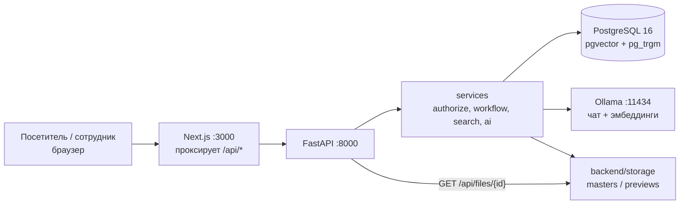
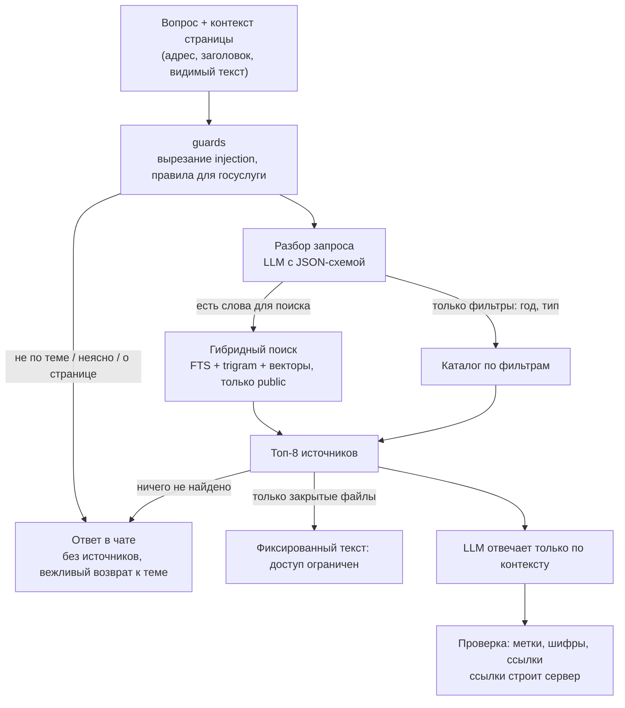

<p align="center">
  
</p>

<h1 align="center">Государственный архив Восточно-Казахстанской области</h1>

<hr>

<p align="center"><b>Каталог, поиск и ИИ-помощник в одном месте: права проверяются на сервере, языковая модель локальная, публикация только через согласование</b></p>

<p align="center">
  
  
  
  
  
  
</p>

<!-- Бейджи статуса (CI, релиз, лицензия) не добавлены: в репозитории нет workflow, релизов и файла LICENSE. -->

<p align="center">
  <a href="#архитектура">Архитектура</a> · <a href="#установка-и-запуск">Быстрый старт</a> · <a href="docs/">Документация</a> · <a href="docs/DEPLOYMENT.md">Почему локальный Docker</a>
  <br>
  <a href="README.md">English</a> · Русский
</p>

---

## Обзор

Новый публичный сайт и админ-панель Государственного архива Восточно-Казахстанской области (хакатон Code Masters 9.0). Единый
электронный каталог (фонды, описи, дела, документы с просмотром скана), поиск на казахском, русском и английском, онлайн-выставки
и «Архив памяти» (коллекции, личности, хронология, историческая карта), карта филиалов и ИИ-помощник, отвечающий только по найденным
на сайте материалам.

Главная инженерная задача — доступ. Закрытый документ не выдаётся ни карточкой, ни прямой ссылкой на файл, ни API, ни ответом ИИ: решение
принимает сервер на каждом пути, а поисковый индекс содержит только публичные объекты. Любой материал публикуется через согласование по
ролям. Сайт только информационный: форм заявлений, заказов и оплаты нет, есть ссылки на eGov.kz и e-Otinish.

## Технологии

| Группа | Технологии | Где зафиксировано |
|---|---|---|
| Основа | Python 3.12, FastAPI, SQLAlchemy 2, Alembic, Pydantic v2 | `backend/requirements.txt`, `backend/Dockerfile` |
| Основа | Next.js 15 (App Router), React 19, TypeScript 5, Tailwind CSS 4, next-intl, next-themes, Leaflet, TipTap | `frontend/package.json` |
| Данные | PostgreSQL 16 с pgvector и pg_trgm | `docker-compose.yml` (`pgvector/pgvector:pg16`) |
| Данные | Файлы на диске (`backend/storage`), Pillow, pypdfium2 для превью | `backend/requirements.txt` |
| ИИ | Ollama: чат-модель `qwen3.5:9b-q4_K_M`, эмбеддинги `bge-m3` (1024) | `.env.example`, `docker-compose.yml` |
| ИИ | Tesseract (`rus+kaz+eng`) для OCR в инструментах сотрудников | `backend/Dockerfile` |
| Доступ | пароли argon2id, JWT в `HttpOnly` `SameSite=Strict` cookie, необязательный вход посетителей через Google | `backend/app/security.py` |
| Инфраструктура | Docker Compose (db, ollama, ollama-models, backend, frontend), Makefile | `docker-compose.yml`, `Makefile` |

## Архитектура

Слои, модель данных и контракт API — в [docs/ARCHITECTURE.md](docs/ARCHITECTURE.md).



Браузер работает с одним origin: Next.js перенаправляет `/api/*` на FastAPI, поэтому cookie сессий остаются `SameSite=Strict`.

### ИИ-помощник



Если Ollama недоступна, поиск и каталог работают, а ИИ-блоки показывают фиксированный текст «временно недоступен». Подробности: [docs/AI.md](docs/AI.md).

### Решения

| Решение | Почему | Запись |
|---|---|---|
| Поиск внутри PostgreSQL, без отдельного поискового сервера | Одно хранилище для резервных копий и одно место, где соблюдается видимость; полнотекст, триграммы и векторы объединяются через RRF | [docs/DECISIONS.md](docs/DECISIONS.md) |
| Права в сервисах через единый `authorize(user, action, obj)` | Закрытые файлы и черновики не утекут через забытый маршрут; отказ — 404, а не 403 | [docs/DECISIONS.md](docs/DECISIONS.md) |
| Локальный Docker вместо облачной платформы | Персональные данные должны храниться в базе на территории Казахстана; платформа поставщика потребовала бы переписать слои данных и авторизации | [docs/DEPLOYMENT.md](docs/DEPLOYMENT.md) |

## Структура проекта

```text
.
├── backend/            приложение FastAPI
│   ├── app/            routers, services, repositories, models, ai
│   ├── alembic/        миграции базы данных
│   ├── seed/           демо-контент, реальные изображения, готовые переводы, bootstrap
│   └── tests/          тесты pytest (матрица доступа, ИИ, поиск, согласование)
├── frontend/           сайт и админка на Next.js (src/app, src/components, messages kk/ru/en)
├── info/               исходные файлы заказчика для seed (история, контакты, филиалы, фонды)
├── docs/               архитектура, ИИ, решения, обоснование развёртывания, сценарий демо
├── docker-compose.yml  db, ollama, ollama-models, backend, frontend
├── docker-compose.gpu.yml  необязательная видеокарта NVIDIA для Ollama
└── Makefile            env, up, dev, test, backup
```

## Установка и запуск

### Всё в Docker (рекомендуется)

```bash
git clone <repository-url> && cd <repository-directory>
make up            # создаёт .env со случайными секретами и запускает `docker compose up --build`
```

Без `make`:

```bash
cp .env.example .env     # задать POSTGRES_PASSWORD, JWT_SECRET и DEMO_PASSWORD
docker compose up --build
```

При первом запуске стек скачивает модели Ollama (несколько ГБ), применяет миграции, загружает демо-каталог и создаёт демо-аккаунты
сотрудников. Сайт: <http://localhost:3000>, API: <http://localhost:8000>, документация API — `/docs`.

> [!NOTE]
> С видеокартой NVIDIA: `docker compose -f docker-compose.yml -f docker-compose.gpu.yml up --build`. На процессоре помощник работает, но
> отвечает медленно. Поиск и каталог от модели не зависят.

> [!WARNING]
> Cookie сессии помечена `Secure`. Браузеры принимают её на `http://localhost`; если сайт открыт по IP-адресу через обычный http,
> задайте `SESSION_COOKIE_SECURE=false` в `.env`.

### Демо-аккаунты

Создаются при первом запуске, если задан `DEMO_PASSWORD` (`make env` ставит `Demo-Pass-2026!`). Админка: `/ru/admin`.

| Роль | Логин |
|---|---|
| Главный администратор | `superadmin@demo.kz` |
| Администратор сайта | `siteadmin@demo.kz` |
| Редактор | `editor@demo.kz` |
| Архивист | `archivist@demo.kz` |
| Модератор | `moderator@demo.kz` |
| Аналитик | `analyst@demo.kz` |

### Локальная разработка без Docker для приложения

```bash
make dev                    # env-файлы, PostgreSQL в Docker, зависимости, миграции, затем API на :8000 (остаётся на переднем плане)
# в других терминалах:
cd backend && DEMO_PASSWORD='Demo-Pass-2026!' .venv/bin/python -m seed.bootstrap   # роли, демо-данные, демо-аккаунты, поисковый индекс
make frontend-install && make frontend-dev         # сайт на :3000
make test                                          # тесты backend
```

Установите [Ollama](https://ollama.com) и скачайте модели: `ollama pull qwen3.5:9b-q4_K_M && ollama pull bge-m3`. Для OCR нужен Tesseract
(`sudo apt install tesseract-ocr tesseract-ocr-rus tesseract-ocr-kaz tesseract-ocr-eng`).

<details>
<summary>Переменные окружения</summary>

Корневой `.env` (Docker Compose):

| Переменная | По умолчанию | Назначение |
|---|---|---|
| `POSTGRES_USER` | `vko` | Пользователь базы |
| `POSTGRES_PASSWORD` | `change_me` | Пароль базы (`make env` создаёт случайный) |
| `POSTGRES_DB` | `vko_archive` | Имя базы |
| `POSTGRES_PORT` | `5432` | Порт на хосте, только localhost |
| `JWT_SECRET` | `change_me_jwt_secret` | Ключ подписи токенов сессий, не менее 32 случайных символов |
| `DEMO_PASSWORD` | `change_me_demo_password` | Пароль демо-аккаунтов; пусто — аккаунты не создаются |
| `OLLAMA_MODEL` | `qwen3.5:9b-q4_K_M` | Чат-модель, скачивается при первом запуске |
| `OLLAMA_EMBED_MODEL` | `bge-m3` | Модель эмбеддингов |
| `SESSION_COOKIE_SECURE` | `true` | Помечать cookie сессий как `Secure` |
| `GOOGLE_CLIENT_ID` | пусто | Включает «Войти через Google» в кабинете посетителя |

Настройки только backend (`backend/.env.example`): `OLLAMA_URL`, `OLLAMA_FALLBACK_MODEL`, `OLLAMA_VISION_MODEL`, `OLLAMA_NUM_CTX`,
`OLLAMA_NUM_PREDICT`, `AI_MAX_CONCURRENT_GENERATIONS`, `AI_RATE_LIMIT_PER_MINUTE`, `FRONTEND_URL`, `SMTP_*` (при пустом `SMTP_HOST`
письма не отправляются), `CORS_ORIGINS`.

</details>

<details>
<summary>Если что-то не работает</summary>

- Помощник пишет, что недоступен: модели ещё скачиваются (`docker compose logs ollama-models`) или `ollama` не прошёл проверку здоровья.
- Поиск находит слова, но не по смыслу: векторы считаются после первого запуска и появляются, когда в Ollama есть модель `bge-m3`.
- Сбросить всё: `docker compose down -v && docker compose up --build` пересоздаст базу, файлы и аккаунты.
- Резервная копия: `make backup` пишет `pg_dump` в `backups/`.

</details>

## Документация

| Что | Ссылка |
|---|---|
| Сценарий демо | [docs/DEMO_SCRIPT.md](docs/DEMO_SCRIPT.md) |
| Источники данных и лицензии изображений | [docs/DATA_SOURCES.md](docs/DATA_SOURCES.md) |

## Лицензия

<!-- TODO: add a LICENSE file and name it here --> _TBD_: файла LICENSE в репозитории нет. Изображения Wikimedia Commons сохраняют свои
лицензии (см. `backend/seed/assets/credits.json`).
