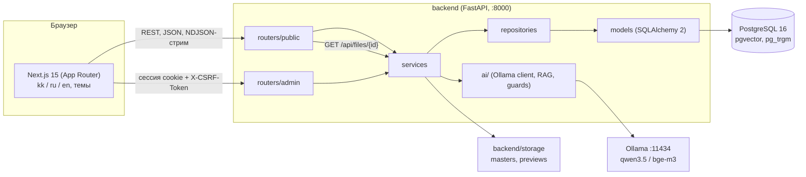
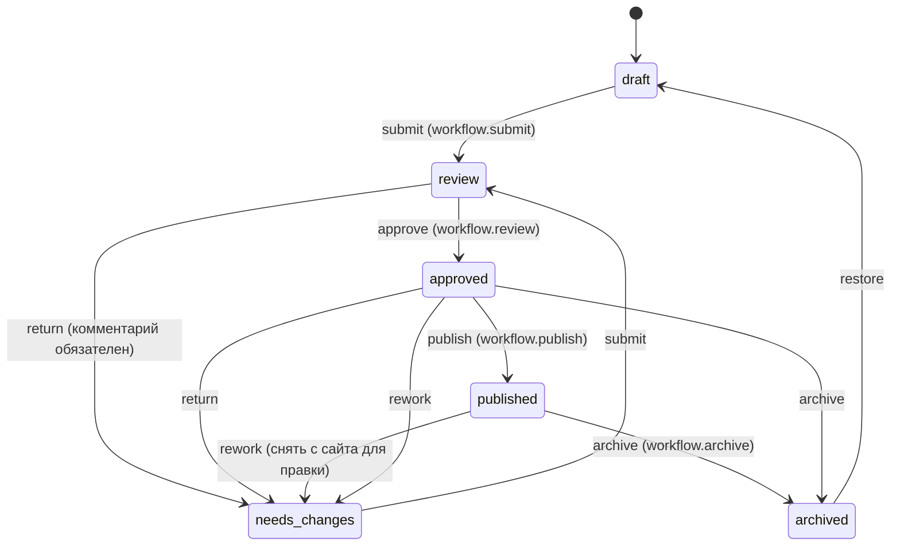
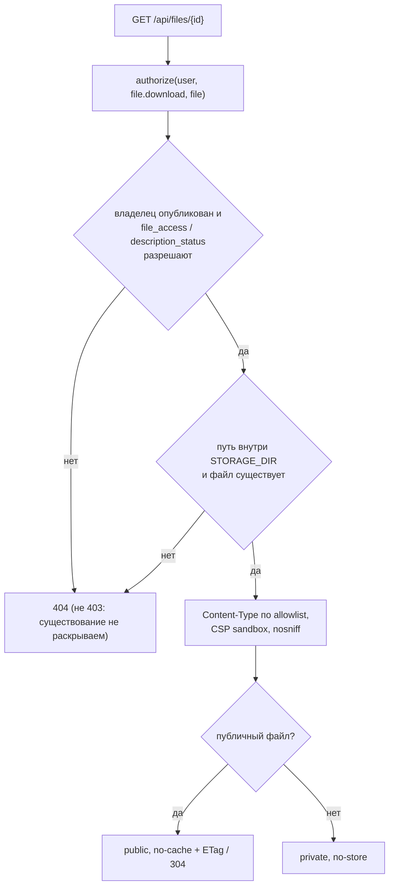
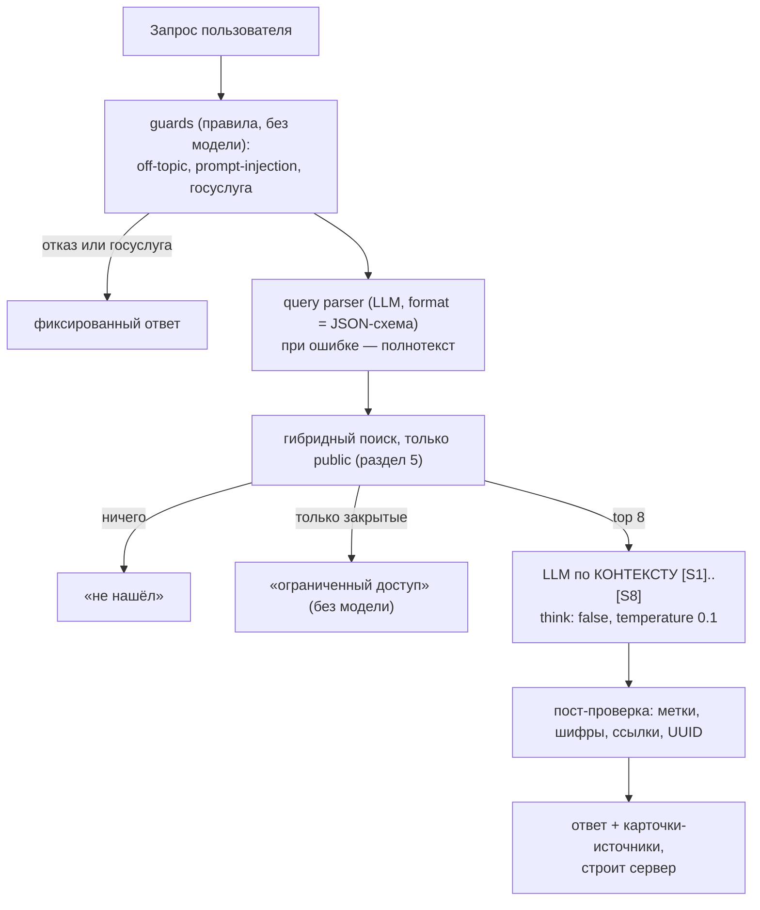
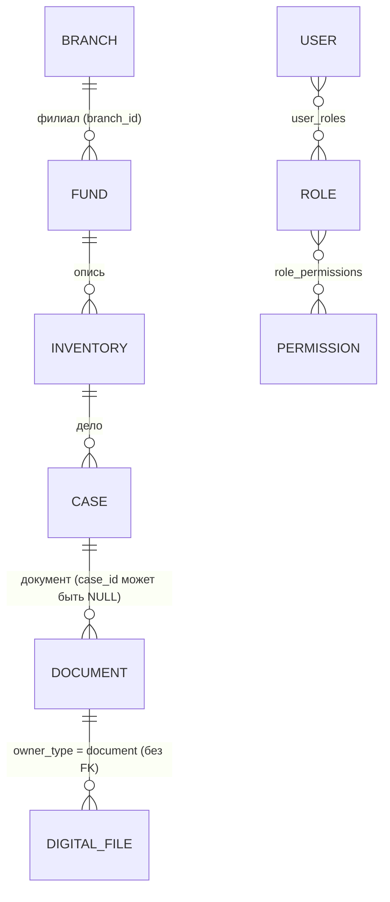

# Архитектура сайта Госархива ВКО

Документ описывает, как устроен код сейчас. Причины решений — в [DECISIONS.md](DECISIONS.md) (номера пунктов указаны в скобках),
ИИ подробно — в [AI.md](AI.md), открытые хвосты — в [OPEN_ISSUES.md](OPEN_ISSUES.md).

## 1. Компоненты

Frontend ходит в API двумя путями: из браузера (клиент `src/lib/api/client.ts`) и с сервера Next.js при рендеринге
(тот же адрес `NEXT_PUBLIC_API_URL`). Сервер Next.js не имеет собственной бизнес-логики и не работает с БД.

## 2. Слои backend

| Слой | Каталог | Что делает |
|---|---|---|
| Маршруты | `app/routers/public/`, `app/routers/admin/` | HTTP, разбор запроса через Pydantic, вызов сервиса, код ответа |
| Схемы | `app/schemas/` | контракт API (вход и выход), отдельно от моделей |
| Сервисы | `app/services/` | бизнес-правила: `authorize`, переходы workflow, поиск, индексация, ИИ, файлы, сессии |
| Репозитории | `app/repositories/` | SQLAlchemy-запросы |
| Модели | `app/models/` | таблицы (см. раздел 9) |
| ИИ | `app/ai/` | клиент Ollama, промпты, парсер запроса, RAG, ограждения, eval |

Правило слоёв: маршрут вызывает сервис, сервис — репозиторий. Проверка прав находится в сервисе, а не в маршруте.
Исключение: два административных маршрута (`routers/admin/catalog.py`, `routers/admin/audit.py`) обращаются к
репозиториям напрямую; это отступление от правила, которое пока не вынесено в сервис.

Общие точки:

- `app/config.py` — настройки из `backend/.env` (pydantic-settings), валидация CORS и `JWT_SECRET`.
- `app/db.py`, `app/deps.py` — сессия БД и зависимости FastAPI (текущий пользователь, CSRF).
- `app/http_security.py` — заголовки безопасности для всех ответов.
- `app/services/errors.py` — доменные исключения; `app/main.py` сопоставляет их с HTTP-кодами
  (`401` вход/сессия, `403` право/CSRF, `404` объект или файл, `409` конфликт версии, `415`/`413` файл, `422` неверные данные, `429` лимит).

## 3. Права доступа и согласование

### 3.1 Единая проверка `authorize`

Все проверки доступа проходят через `authorize(user, action, obj)` в `app/services/authz.py`.
Действие — строка `module.action`; объект — то, над чем действие совершается (или `None`, когда проверяется
только наличие права, например для списков и форм создания).

- Анонимный пользователь (`user=None`) получает право только на `file.download` (проверка по файлу, см. раздел 6).
- Главный администратор (`super_admin`) проходит все проверки, кроме собственных ролей и собственного статуса.
- Никто не меняет собственные роли и не блокирует себя (`users.assign_role`, `users.manage`).
- `roles.manage` (редактирование матрицы прав) — только главный администратор, вне матрицы.
- `users.assign_role` — отдельное действие вне матрицы, выводится из `users.manage`; не главный администратор
  не выдаёт и не снимает `super_admin` (п. 24).

Каталог прав (`PERMISSIONS`):

| Модуль | Действия |
|---|---|
| `catalog` | view, create, edit, delete, import, export |
| `files` | view, upload, delete |
| `content` | view, create, edit, delete |
| `branches` | view, create, edit, delete |
| `users` | view, manage |
| `settings` | edit |
| `audit` | view, export |
| `workflow` | submit, review, publish, archive |
| `ai` | use |
| `analytics` | view |

Семь системных ролей (`RoleCode`): `super_admin`, `site_admin`, `editor`, `archivist`, `branch_admin`, `moderator`,
`analyst`. Матрица «роль → право» хранится в БД (`permissions`, `role_permissions`). Значения по умолчанию
(`DEFAULT_ROLE_PERMISSIONS`) применяются только при создании роли; правка матрицы из админки на них не влияет.

**Филиальная область.** Если все роли пользователя входят в {`branch_admin`, `archivist`} и у него задан `branch_id`
(для `branch_admin` всегда), объект должен принадлежать его филиалу. Филиал объекта каталога выводится из иерархии
дело → опись → фонд (`documents.branch_id` синхронизируется при сохранении). Списки таких пользователей
дополнительно фильтруются по `branch_id`.

### 3.2 Workflow и версии

Статусы (`WorkflowStatus`): `draft`, `review`, `needs_changes`, `approved`, `published`, `archived`.

- Переход проверяет право из таблицы `TRANSITIONS` и допустимый исходный статус; `publish` при машинном переводе
  (`machine`) на любом языке отклоняется `409 unverified_translation` (п. 77).
- Сохранение и переход выполняются в одной транзакции (`workflow.save_with_version`): оптимистическая блокировка
  `UPDATE … WHERE version = :v`, при расхождении — `409 version_conflict`.
- История — снимки в `workflow_history.snapshot`; diff считается между соседними снимками.
- Правка объекта в статусе `approved`/`published` требует `workflow.publish`. Исключение — сужение доступа
  (`file_access`, `description_status`), его может сделать архивист. Остальные правки живого объекта идут через `rework`:
  объект снимается с сайта и проходит согласование заново (п. 76).
- Публикация не меняет `file_access` у файлов (п. 22).
- Уведомления (`notifications`) получают участники перехода: рецензенты при `submit`, автор и отправитель при остальных.
- Индекс поиска пересчитывается в той же транзакции, что и переход (раздел 5).

### 3.3 Журнал действий

`audit_logs` — журнал действий (кто, что, с каким объектом, результат, без паролей и секретов). Отказ в доступе
записывается отдельным коммитом (`result=denied`) после отката запроса (п. 21). Таблица защищена триггером
`audit_logs_append_only`: `UPDATE` и `DELETE` отклоняются, кроме обнуления `user_id` внутри FK-действия при удалении
пользователя (п. 79). Защита от ошибок приложения, не от владельца БД.

## 4. Аутентификация и сессии

| Что | Как |
|---|---|
| Пароли | argon2id (`argon2-cffi`), длина 10–256; неизвестный e-mail проверяется по фиктивному хешу |
| Вход | одинаковый ответ `401 invalid_credentials` для неизвестного e-mail, неверного пароля и заблокированной учётки |
| Блокировка | 5 неудач подряд → учётка заблокирована на 15 минут; счётчик общий со сменой пароля (п. 25, 26) |
| Сессия | JWT HS256 (PyJWT) в cookie `vko_session`: httpOnly, Secure, SameSite=Strict |
| Срок сессии | скользящее окно 30 минут неактивности, не дольше 12 часов от входа (claim `auth_time`) |
| CSRF | claim `csrf` внутри JWT; значение в cookie `vko_csrf` (читается фронтом) и в заголовке `X-CSRF-Token` на POST/PUT/PATCH/DELETE; сравнение `hmac.compare_digest` |
| Выход и смена пароля | `session_version` у пользователя и посетителя; выход и смена пароля увеличивают его, старые токены отклоняются (п. 78, 90) |
| Деактивация | пользователь читается из БД на каждом запросе — блокировка действует сразу |
| Лимит входа | 20 попыток в минуту с IP (`429` + `Retry-After`) поверх блокировки учётки (п. 83) |

Ключ `JWT_SECRET` берётся только из окружения; значение `change_me…` отклоняется.
Посетители (личный кабинет, `/api/cabinet`) имеют отдельную сессию и отдельный `session_version`.
Сброс пароля и подтверждение e-mail — одноразовые токены в `visitor_tokens` (хранится SHA-256), письма через SMTP (`services/mailer.py`, `services/visitor_tokens.py`; п. 94).

## 5. Поиск

### 5.1 Индекс

Одна таблица `search_entries`: строка = (`object_type`, `object_id`, `lang`, `chunk_no`), поля `title`, `body`,
`tsv` (tsvector), `embedding` (vector(1024)), `embedding_model`.

- GIN по `tsv`, GIN trigram по `title`, HNSW (`vector_cosine_ops`) по `embedding` (миграция `0001`).
- Размерность `1024` зафиксирована константой `EMBEDDING_DIM` (`app/models/base.py`) и получена запросом к bge-m3 (п. 3).
- Попадают только публичные объекты: документ — `published` и `description_status = public`; фонд, страница, филиал,
  выставка, коллекция, новость — `published`. Персоны, события и НПА пока не индексируются (п. 33).
- Текст OCR — только файлов, которые может скачать аноним; чанки хранят `file_id` и перепроверяются при поиске (п. 43).
- Стартовые синонимы (топонимы, сокращения, ru/kk/en) пишет команда индексации, если таблица `synonyms` пуста (п. 39).

### 5.2 Запрос

1. Полнотекст: конфиг `simple` (у PostgreSQL нет казахского стеммера); слова ≥ 6 букв усекаются на 2 буквы;
   синонимы — OR-альтернативы; сначала все слова (AND), при пустом результате — любое (OR) (п. 35).
2. Опечатки: `word_similarity` запроса к заголовку, порог 0.6.
3. Семантика: вектор запроса (bge-m3, таймаут 2 с), косинусное расстояние ≤ 0.5. Если Ollama недоступна,
   запрос идёт без векторов; после ошибки повторная попытка через 30 секунд (п. 35).
4. Каждый метод отдаёт до 200 кандидатов; слияние — Reciprocal Rank Fusion, `k = 60`.
5. Перед выдачей каждый кандидат перепроверяется по живому объекту (`INDEXED_TYPES[...].is_public`): устаревшая строка
   индекса не попадает ни в выдачу, ни в счётчики, ни в фасеты (п. 32).
6. Фасеты (тип, вид документа, период, филиал) считаются в Python по проверенному набору, дизъюнктивно.
7. Сниппеты — `ts_headline` с маркерами из Private Use Area; затем HTML-экранирование и замена маркеров на `<mark>` (п. 36).
8. Ссылки в выдаче строит сервер (`href` без префикса локали). Пути файлов в ответах не возвращаются (п. 37).

`/api/search` одинаков для всех пользователей: индекс содержит только публичное (п. 44). Служебный поиск по закрытому —
в админке, отдельно. `total` ограничен суммой кандидатов (около 600).

### 5.3 Синхронность индекса

`save_with_version` вызывает `indexing.reindex_object` в той же транзакции: снятие с публикации удаляет строки до коммита.
Векторы считаются после ответа (фоновая задача после перехода, не больше 200 строк за раз, под `pg_try_advisory_lock`)
или командой `python -m app.services.indexing`. При неизменном тексте вектор сохраняется.

### 5.4 Каталог

`/api/catalog` не использует полнотекст: фильтры по `documents` через ILIKE (п. 49). Категории (`historical`, `photos`,
`maps`, `written`, `organizations`, `personal`, `audio_video`) сопоставляются на сервере фиксированными правилами (п. 48).
Видимость: документ публичен при `published` и `description_status = public`; фонд, опись и дело видны, только если
опубликованы все родители (п. 47).

## 6. Файлы и доступ

Все файлы отдаются только через `GET /api/files/{id}`; каталог `backend/storage/` статикой не раздаётся.

- Файл отдаётся, только если и файл (`digital_files.access`), и владелец (документ с `file_access` и публичным описанием)
  разрешают выдачу этому пользователю (п. 14). Сотрудник с `files.view` видит закрытые файлы в пределах своего филиала.
- Inline только для allowlist (`image/png|jpeg|webp|gif`, `application/pdf`, `text/plain`, `audio/*`, `video/*`);
  остальное — `attachment` (п. 40). Все ответы: `Content-Security-Policy: default-src 'none'; …; sandbox`.
- Кеш: публичные — `ETag`/304 (304 отдаётся только после проверки прав); по правам сотрудника — `private, no-store`,
  поэтому закрытие файла действует сразу (п. 41).
- Новые файлы к живому документу грузятся как `needs_review` и не ставят `has_digital_copy` (п. 76).
- Next.js отдаёт картинки через `next/image` только с origin API и путём `/api/files/**`; оптимизатор запрашивает файл
  как аноним, поэтому закрытый файл не попадёт в его кеш (п. 87).

## 7. ИИ (локально, Ollama)

Подробности, модели, параметры и таблица eval — в [AI.md](AI.md). Схема ответа:

Защита:

- Контекст содержит только публичные объекты; у документов с закрытыми файлами — название, шифр, дата и условия доступа.
- Запрос пользователя передаётся отдельным сообщением между `<<<` и `>>>`; угловые скобки удаляются.
- Текст документа и история диалога — данные: метки `[Sn]` и команды внутри них не исполняются.
- После модели удаляются метки, которых нет в контексте, шифры, которых нет у объектов контекста, все URL, домены, e-mail,
  пути сайта и UUID; допускаются только `egov.kz` и `eotinish.kz`.
- Карточки-источники и ссылки на маршруты 2GIS/Google/Яндекс строит сервер, модель их не формирует.
- Лимиты: 2 одновременные генерации на процесс, 10 запросов в минуту с IP на ИИ-маршруты (счётчики в памяти процесса).

ИИ не принимает и не оформляет заявки, заказы и справки: ответы — информация, а не архивная справка (метка в UI).

## 8. Фронтенд

- **Маршрутизация.** Next.js 15 App Router; все страницы под `src/app/[locale]/`. Языки `kk`, `ru`, `en`, по умолчанию `ru`
  (`src/lib/i18n/routing.ts`). `src/middleware.ts` (next-intl) выбирает локаль; служебные пути и файлы не перехватываются.
- **Строки интерфейса.** Только словари `messages/{kk,ru,en}.json` через next-intl. Паритет ключей трёх языков проверен
  (см. [DATA_SOURCES.md](DATA_SOURCES.md)). Перевод kk/en — машинный, нужна вычитка.
- **Темы.** `next-themes` (`src/components/layout/theme-provider.tsx`); цвета — CSS-переменные в `src/app/globals.css`,
  тёмная тема переопределяет их.
- **Данные.** Публичные настройки сайта (`/api/site-settings`) читаются один раз в `[locale]/layout` с
  `revalidate` 60 с и раздаются через контекст; при сбое API действуют значения по умолчанию (п. 88).
- **Редактор текста.** Tiptap в админке; HTML санитизируется на сервере (`clean_html`, `nh3`) и экранируется React.
- **Карта.** Leaflet с тайлами OpenStreetMap; сбой тайлов не ломает страницу. Маршруты открываются ссылками на
  2GIS, Google Maps и Яндекс, без ключей.
- **Безопасность заголовков.** CSP в `next.config.ts`: `script-src 'self' 'unsafe-inline'` (App Router требует инлайн-скрипты
  гидратации; `'unsafe-eval'` только в dev), `frame-ancestors 'none'`, `form-action 'self'` (п. 82).

## 9. Модель данных

Модели — `app/models/` (`base.py`, `catalog.py`, `content.py`, `files.py`, `search.py`, `users.py`, `branches.py`,
`exhibitions.py`, `memory.py`, `annotations.py`, `cabinet.py`, `system.py`). Схема — миграции Alembic в `backend/alembic/versions/`.
Тест `test_models_match_migrations` сверяет модели с миграциями.

- **Иерархия каталога** фонд → опись → дело → документ, связи FK с `ON DELETE RESTRICT`: родителя с потомками удалить нельзя (п. 5).
  Шифр документа (`archive_code`) — отдельное уникальное поле; стабильный id — uuid.
- **Общие поля** (`ContentMixin`): uuid, slug, created/updated, `created_by`, `workflow_status`, `version`,
  `translation_status` (JSONB по языкам). Переводимые поля — JSONB `{"kk", "ru", "en"}` (п. 6).
- **Полиморфные ссылки без FK** (`digital_files.owner_type/owner_id`, `collection_items`, `workflow_history`,
  `audit_logs`): целостность проверяет сервисный слой (п. 7).
- **Ограничения схемы**: номер фонда уникален в пределах филиала, e-mail уникален без учёта регистра, CHECK на даты
  и координаты (миграция `0002`, п. 16).
- **Права файла** (`digital_files.access`) — собственный уровень, не наследуется от владельца (п. 14).

## 10. Тесты и сборка

- `backend/tests/` — pytest на реальной PostgreSQL; тестовая база (`TEST_DATABASE_URL`) пересоздаётся каждой сессией (п. 12).
- `frontend/e2e/` — Playwright: `npm run e2e` поднимает отдельный стенд (API :8201, web :3201, база `vko_archive_e2e`)
  и гасит его после прогона .
- `Makefile` — `make dev`, `make env`, `make migrate`, `make test`, `make backup`.

## 11. Ограничения прототипа

- Лимиты и счётчики — в памяти процесса: при нескольких воркерах лимит считается на каждый воркер (п. 83).
- Регистрация посетителя раскрывает занятость e-mail (п. 84, 86 — принятый риск прототипа).
- Выход отзывает сессии на сервере через `session_version` (п. 78). Письма (сброс пароля, подтверждение e-mail) уходят только при настроенном SMTP (п. 94, 95); без него ссылок нет.
- OCR демо-файлов — имитация (текст страницы = текст скана); реальный Tesseract работает для загруженных сотрудником файлов (п. 96).
- PDF открывается файлом, pdf.js не встроен (см. OPEN_ISSUES).

Полный список — в [OPEN_ISSUES.md](OPEN_ISSUES.md), статус по ТЗ — в [READINESS.md](../READINESS.md).
